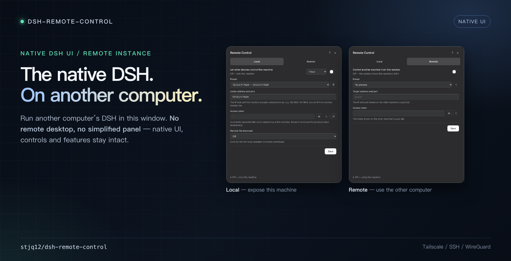

# Remote Control for DeepSeek Harness

[简体中文](README.md) · [Install](INSTALL.md) · [Technical](TECHNICAL.md)



A DeepSeek Harness plugin that establishes remote control between two computers, letting one computer operate a DeepSeek Harness instance running on another computer.

## What it does

- **One window, two hosts.** Keep DSH on a desktop or server and use it from another computer.
- **Local / Remote.** Local exposes an authenticated `/bridge`; Remote routes this window's traffic to it.
- **Approvals and downloads.** While a controller is attached, approvals and AI questions are answered remotely. Downloads can be limited to a chosen directory.

## Install

Install the same plugin on both machines.

From GitHub:

```text
github:stjq12/dsh-remote-control
```

In DSH, open **Plugins → Add plugin** and enter the GitHub spec, or use this checkout's absolute path. Host-side code loads only when DSH starts; fully quit and restart DSH after replacing it.

## Quick start

1. **Controlled machine — Local.** Choose an IP this machine already has and a port at 1024 or higher. Turn the switch on, then copy the token.
2. **Controller — Remote.** Enter the address and token shown on the other machine, then turn the switch on.
3. The page reloads once. Turn the switch off to return to the local Host.

**Save** stores the form only; the switch applies it. Selecting a preset fills the form but does not connect.

## Security

Remote Control is full-control access, not a read-only viewer.

- The bridge uses plaintext `ws://` and a bearer token. Use it only over Tailscale, SSH, WireGuard, or another encrypted tunnel.
- The token is equivalent to full control of the controlled Harness. Do not share or screenshot it; rotate it immediately if it may have leaked.
- Prefer a bounded lifetime (5 minutes to 24 hours) and close the switch when done. Permanent still ends when DSH exits.
- The download policy controls downloads only. Previews may still read files through RPC; grant the narrowest directory that contains what you need.
- Do not give the token to an untrusted controller. Test in a controlled environment first.

See [TECHNICAL.md](./TECHNICAL.md) for the protocol, threat model and diagnostics.

## Limitations

- `ws://` only; no WSS/TLS.
- Remote file upload is not supported.
- Byte RPC results are capped at 64 MB; normal downloads use 256 KB chunks.

## Documentation

- [INSTALL.md](./INSTALL.md)
- [TECHNICAL.md](./TECHNICAL.md)

## License

[MIT](LICENSE) © stjq12

## Repository

- GitHub: https://github.com/stjq12/dsh-remote-control
