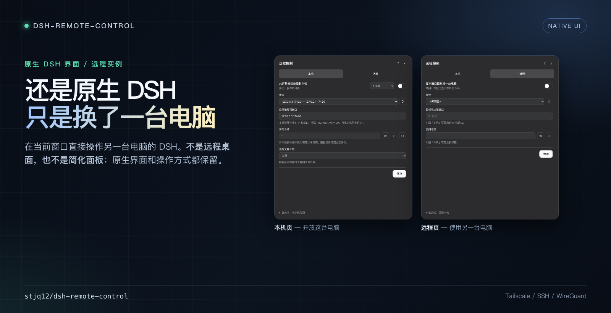

# DeepSeek Harness 远程控制

[English](README.en.md) · [安装](INSTALL.md) · [技术说明](TECHNICAL.md)



一个 DeepSeek Harness 插件，用于在两台电脑之间建立远程控制，让一台电脑操作另一台电脑上运行的 DeepSeek Harness 实例。

## 功能

- **两台电脑，一个窗口。** DSH 放在台式机或服务器，人在另一台电脑上继续使用。
- **本机页 / 远程页。** 本机页开放带凭据的 `/bridge`，远程页把当前窗口的流量接到对端。
- **审批与下载。** 有远程控制端时，审批和 AI 提问由远程端回答；下载可以限定到指定目录。

## 安装

两台电脑安装同一个插件。

从 GitHub 安装：

```text
github:stjq12/dsh-remote-control
```

在 **DSH → 插件 → 添加插件** 输入 GitHub 地址，或使用本地绝对路径。Host 侧代码只在 DSH 启动时加载；替换后需完全退出并重新启动 DSH。

## 快速开始

1. **被控制端 — 本机页。** 选择本机已有的 IP 和 1024 以上端口，打开开关，复制 token。
2. **控制端 — 远程页。** 填写对端显示的地址和 token，打开开关。
3. 页面会刷新一次。关闭开关即可回到本机 Host。

**保存**只记录表单，开关才真正生效；选择预设只填表单，不会自动连接。

## 安全

这是完整控制权限的远程控制，不是只读查看器。

- bridge 使用明文 `ws://` 和 bearer token。只应通过 Tailscale、SSH、WireGuard 等加密隧道使用。
- token 等价于被控端 Harness 的完整控制权限。不要分享或截图；怀疑泄露时立即轮换。
- 优先使用 5 分钟到 24 小时的有限时长，用完关闭开关。永久选项也会在 DSH 退出时结束。
- 下载权限只控制下载；预览仍可能通过 RPC 读取文件。只授权包含所需文件的最窄目录。
- 不要把 token 交给不受信任的控制端。请先在受控环境测试。

协议、威胁模型和诊断说明见 [TECHNICAL.md](./TECHNICAL.md)。

## 限制

- 只支持 `ws://`，不支持 WSS/TLS。
- 不支持远程上传文件。
- 字节 RPC 结果有 64 MB 上限；普通文件下载走 256 KB 分块流。

## 文档

- [INSTALL.md](./INSTALL.md)
- [TECHNICAL.md](./TECHNICAL.md)

## 致谢

本项目采用同样的远程访问思路：通过带认证的 WebSocket 把 Host 暴露给另一客户端，再做适配。该思路参考了 [Clarklevis1995/dsh-plugin-mobile-gateway](https://github.com/Clarklevis1995/dsh-plugin-mobile-gateway)，感谢作者分享。

## 许可证

[MIT](LICENSE) © stjq12

## 仓库

- GitHub：https://github.com/stjq12/dsh-remote-control
